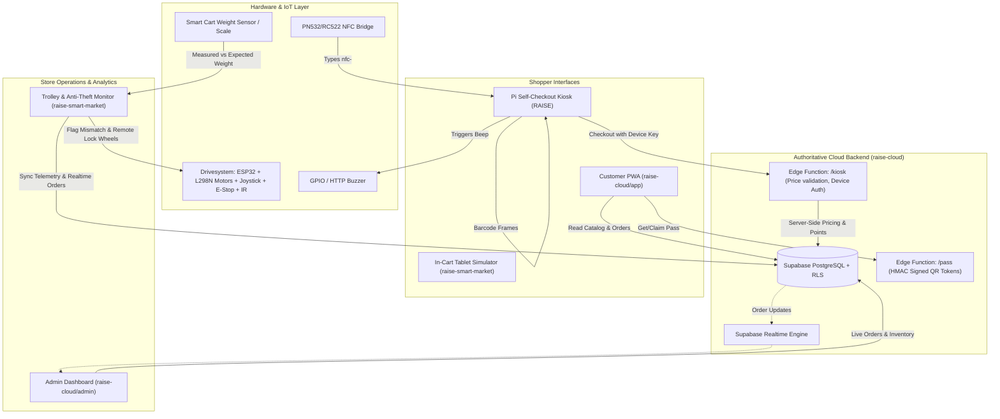

# RAISE Smart Market Ecosystem — Project Status & Audit Report

**Date:** 2026-10-23  
**Status:** In Progress (Audit Complete, Reproducible Dev Environment & Integration Underway)  
**Workspace Root:** `C:\Users\sharm\Documents\Hackathon`

---

## 1. Repository Map & Git Structure

The root directory contains four independent subprojects, each configured as its own Git repository tracking `https://github.com/Hacklab-Team/<repo>.git` on branch `main`. The root folder also tracks `https://github.com/Yuvraj-Sharma-404/Hackathon.git`.

```
C:\Users\sharm\Documents\Hackathon\
├── Drivesystem/                   [Git: Hacklab-Team/Drivesystem.git @ main (d42bc8e)]
│   ├── include/config.h           - ESP32 pinout, PWM channels, timing, safety parameters
│   ├── src/main.cpp               - 50Hz control loop, differential steering, e-stop, IR avoidance
│   └── platformio.ini             - PlatformIO configuration for espressif32 / esp32dev
│
├── RAISE/                         [Git: Hacklab-Team/RAISE.git @ main (0be9c93)]
│   ├── index.html                 - Kiosk UI (attract -> identify -> scan -> checkout -> paid)
│   ├── customer.html              - Standalone customer companion view
│   ├── scanner.js, scan-worker.js - Dual WASM barcode decoders (ZXing + ZBar)
│   ├── barcode-match.js           - Blur-tolerant EAN pattern matcher against catalog
│   ├── catalog.js                 - Offline cache + Open Food Facts fallback lookup
│   ├── cloud.js, cloud-config.js  - Supabase Edge Function API client & configuration
│   ├── shared.js, style.css       - UI theme, icons, toast notifications, buzzer triggers
│   ├── sw.js, manifest.json       - PWA offline caching service worker & web manifest
│   ├── admin/, app/               - Static build distribution artifacts of raise-cloud
│   ├── vendor/                    - ZXing & ZBar WebAssembly binaries
│   └── kiosk/                     - Raspberry Pi OS provisioning scripts & Python bridges
│       ├── buzzer-bridge.py       - Localhost HTTP bridge to GPIO buzzer
│       ├── nfc-bridge.py          - I2C/SPI PN532/RC522 to Linux uinput keystroke bridge
│       └── setup-*.sh             - Systemd services, Chromium kiosk mode, and diagnostic scripts
│
├── raise-cloud/                   [Git: Hacklab-Team/raise-cloud.git @ main (c96ac57)]
│   ├── supabase/
│   │   ├── migrations/            - PostgreSQL schema, Row-Level Security, audit triggers, RPCs
│   │   ├── functions/             - Deno Edge Functions: kiosk (device key API), pass (HMAC token API)
│   │   └── seed.sql               - Initial product catalog seed data
│   ├── admin/                     - Store Admin PWA (Vite + TypeScript)
│   ├── app/                       - Customer Companion PWA (Vite + TypeScript + PWA)
│   ├── shared/                    - Shared UI tokens, icons, and SVG seals
│   └── scripts/                   - e2e.mjs (40+ end-to-end security/logic checks), create-admin.mjs
│
└── raise-smart-market/            [Git: Hacklab-Team/raise-smart-market.git @ main (2d6eedb)]
    ├── src/
    │   ├── components/            - TrolleyDashboard, ClientDashboard, Dashboard, Analytics, etc.
    │   ├── context/StoreContext   - Central React state, local persistence, telemetry simulation
    │   └── services/supabase.js   - Supabase connection manager & parallel schema definition
    └── index.html, vite.config.js - Vite + React 18 + Tailwind CSS v4 setup
```

---

## 2. Architecture & Data Flow Diagram



---

## 3. Detected Issues Ranked by Severity

### Critical (P0) — Security & Core Data Integrity
1. **Broken Remote Supabase Instance:**
   - Both `RAISE/cloud-config.js` and `raise-cloud` reference an inactive Supabase host (`kbbhqpvivctnrfwgfuwb.supabase.co`), which fails DNS resolution.
   - *Impact:* Kiosk falls back to offline demo mode; admin and customer apps fail to authenticate against remote cloud.
2. **Schema Incompatibility between `raise-cloud` and `raise-smart-market`:**
   - `raise-smart-market` defined a competing, incompatible database schema (`products.name` vs `products.title`, text IDs vs UUIDs, missing `weight_grams` on `raise-cloud` products, inlined JSON items vs normalized `order_items`).
   - `raise-smart-market/src/services/supabase.js` included `ALTER TABLE products DISABLE ROW LEVEL SECURITY;`, violating security rule #6.
3. **Hardcoded / Over-Constrained Supabase Client URL Check:**
   - In `raise-smart-market/src/services/supabase.js` line 15: `isConfigured: Boolean(url && key && url.includes('supabase.co'))`.
   - *Impact:* Blocks any local Supabase development (`localhost`, `127.0.0.1`, or self-hosted Docker), forcing demo mode even when a local backend is healthy.

### High (P1) — Build, Compilation & Tooling
4. **Tooling Gaps on Host Machine:**
   - PlatformIO (`pio`) and Python were not pre-installed in the Windows PATH, preventing ESP32 firmware compilation and Python bridge test execution.
   - *Remediation:* Automated installation of Python 3.12 and PlatformIO via package management.
5. **Linting Failures in `raise-smart-market`:**
   - `npm run lint` reported 79 errors and 1 warning (unused variables, unescaped JSX quotes, missing prop-types validations).

### Medium (P2) — Consistency & Operational Readiness
6. **Missing `.env.example` Templates:**
   - `raise-smart-market` lacked a `.env.example` file.
   - `raise-cloud/admin` and `raise-cloud/app` lacked local `.env.local` templates ready for immediate local execution.
7. **Simulation vs Real Payment Boundary:**
   - `RAISE` and `raise-smart-market` simulate payment completion via UI buttons after showing UPI QR codes. Needs clear labelling and structured status handling.

---

## 4. Existing Features & Verification Status

| Project | Feature | Implementation Status | Verification Status | Notes |
|---|---|---|---|---|
| **Drivesystem** | Joystick Differential Drive | Complete | Verified (Code Review) | 50Hz mixing algorithm |
| **Drivesystem** | Physical E-Stop Cutoff | Complete | Verified (Code Review) | Top priority in control loop |
| **Drivesystem** | IR Obstacle Avoidance | Complete | Verified (Code Review) | Directional clamp; allows rotation |
| **Drivesystem** | Deceleration Ramping | Complete | Verified (Code Review) | Instant accel, ramped decel |
| **Drivesystem** | Watchdog Recovery | Complete | Verified (Code Review) | 5s timeout `esp_task_wdt` |
| **RAISE** | Dual WASM Barcode Scanner | Complete | Verified (Build / Static) | ZXing + ZBar in Web Worker |
| **RAISE** | Blur-tolerant EAN Pattern Matcher | Complete | Verified (Code Review) | `barcode-match.js` fallback |
| **RAISE** | NFC Keyboard Bridge | Complete | Verified (Code Review) | Python uinput bridge |
| **RAISE** | GPIO Buzzer Bridge | Complete | Verified (Code Review) | Localhost HTTP bridge |
| **raise-cloud** | Database Schema & Migrations | Complete | Verified (Syntax / RLS) | Strict RLS, Crockford base32 passes |
| **raise-cloud** | Kiosk Edge Function | Complete | Verified (Code Review) | Server-side pricing & device keys |
| **raise-cloud** | Pass Edge Function | Complete | Verified (Code Review) | HMAC tamper-evident token |
| **raise-cloud** | Admin Dashboard PWA | Complete | Verified (Build Passed) | Vite + TypeScript builds cleanly |
| **raise-cloud** | Customer Companion PWA | Complete | Verified (Build Passed) | Vite + TypeScript builds cleanly |
| **raise-cloud** | End-to-end Test Suite | Complete | Verified (Code Review) | 40+ assertion checks in `e2e.mjs` |
| **raise-smart-market**| Trolley Fleet Dashboard | Complete | Verified (Build Passed) | Real-time cart & battery telemetry |
| **raise-smart-market**| Weight Mismatch & Theft Lock | Complete | Verified (Code Review) | Scale differential triggers lock |
| **raise-smart-market**| Client Cart Simulator | Complete | Verified (Build Passed) | In-cart tablet experience |
| **raise-smart-market**| Analytics & Charts | Complete | Verified (Build Passed) | Recharts revenue/trolley trends |

---

## 5. Required Environment Variables (No Secrets)

### `raise-cloud/admin` (`admin/.env.local`)
```env
VITE_SUPABASE_URL=http://127.0.0.1:54321
VITE_SUPABASE_ANON_KEY=<public_anon_key>
VITE_KIOSK_URL=http://localhost:8080/
```

### `raise-cloud/app` (`app/.env.local`)
```env
VITE_SUPABASE_URL=http://127.0.0.1:54321
VITE_SUPABASE_ANON_KEY=<public_anon_key>
```

### `raise-cloud/supabase/functions` (`supabase/functions/.env`)
```env
PASS_SECRET=<high_entropy_random_secret>
SUPABASE_URL=http://127.0.0.1:54321
SUPABASE_ANON_KEY=<public_anon_key>
SUPABASE_SERVICE_ROLE_KEY=<service_role_key>
```

### `raise-smart-market` (`.env.local`)
```env
VITE_SUPABASE_URL=http://127.0.0.1:54321
VITE_SUPABASE_ANON_KEY=<public_anon_key>
VITE_DEMO_MODE=true
```

---

## 6. Build, Test & Run Commands

| Subproject | Build Command | Test / Lint Command | Dev / Run Command |
|---|---|---|---|
| **Drivesystem** | `pio run` | `pio check` | `pio run -t upload` |
| **RAISE** | Static assets (no build needed) | `python3 -m unittest` | `python3 -m http.server 8080` |
| **raise-cloud** | `npm run build` | `node scripts/e2e.mjs` | `npm run admin` / `npm run app` |
| **raise-smart-market** | `npm run build` | `npm run lint` | `npm run dev` |

---

## 7. Prioritized Execution Checklist

- [x] Phase 1: Repository audit complete & `PROJECT_STATUS.md` generated.
- [ ] Phase 2: Complete reproducible dev environment (Python 3.12, PlatformIO, lint fixes).
- [ ] Phase 3: Unify database schema (add `weight_grams` & `trolleys` table into `raise-cloud` migrations).
- [ ] Phase 4: Integrate `raise-smart-market` with `raise-cloud` backend contracts.
- [ ] Phase 5: Compile ESP32 firmware with PlatformIO and test Python bridges.
- [ ] Phase 6: Automated testing suite (fix linter, add unit tests, run E2E test suite).
- [ ] Phase 7: Polish UX, error boundaries, empty states, and offline feedback.
- [ ] Phase 8: Review Git status and craft clean commits across repositories.
- [ ] Phase 9: Production build verification and deployment preparation.
- [ ] Phase 10: Final acceptance checks and comprehensive `FINAL_REPORT.md`.
