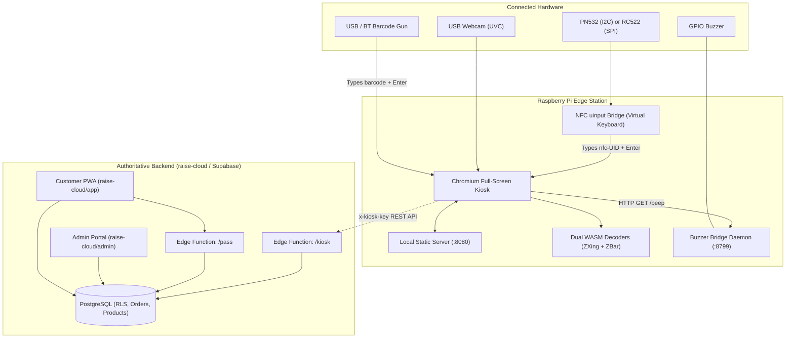

# RAISE & RAISE Cloud — Raspberry Pi Deployment Guide

This guide explains how **RAISE** and **raise-cloud** work together, and provides complete, tested instructions for setting up the self-checkout kiosk on a **Raspberry Pi (3B+, 4, 400, or 5)**.

---

## 1. System Architecture: RAISE vs. RAISE Cloud



### RAISE (The Kiosk Frontend & Hardware Bridges)
- **Role:** Physical Point of Sale (POS) edge device running inside the store.
- **Frontend:** Vanilla HTML/CSS/JS with zero framework overhead — boots fast and runs smoothly even on low-power Pi boards.
- **Barcode Engine:** Dual WebAssembly decoders (ZXing + ZBar) running in a Web Worker, paired with a custom blur-tolerant pattern matcher (`barcode-match.js`) to read low-quality or blurry webcam frames.
- **Hardware Abstraction:**
  - **NFC:** Python daemon converts card taps into virtual keystrokes (`nfc-<uid>\n`) via Linux `uinput`, avoiding browser USB/serial permission hurdles.
  - **Buzzer:** Python HTTP daemon listening on `127.0.0.1:8799` gives instant audio feedback (scans, logins, errors, payments).
- **Offline First:** Fully functional without internet access using local catalog fallbacks, offline service worker (`sw.js`), and pre-bundled static admin and customer apps.

### RAISE Cloud (The Authoritative Backend & Management Layer)
- **Role:** Centralized store database, security, and administrative hub.
- **Database:** Supabase PostgreSQL with strict Row Level Security (RLS) on every table.
- **Edge Functions (Deno):**
  - `/kiosk`: Validates requests using hashed kiosk device keys (`x-kiosk-key`), performs server-side price calculation (preventing tampered price hacks), creates orders, and awards loyalty points.
  - `/pass`: Issues and claims HMAC-signed cryptographic passes (`RAISE2.<pass_id>.<signature>`).
- **Store Admin Portal (`admin/`):** Real-time orders, catalog updates, customer points, and kiosk device management.
- **Customer Companion PWA (`app/`):** Shopper mobile interface for digital passes, points, and receipts.

---

## 2. Hardware Bill of Materials (BOM)

| Component | Recommended Model | Notes |
|---|---|---|
| **SBC** | Raspberry Pi 4 (2GB/4GB/8GB) or Pi 5 | Pi 3B+ works; Pi 4/5 provides fastest WASM decoding. |
| **OS Storage** | 16 GB+ MicroSD card (Class 10 / A1 or A2) | Raspberry Pi OS (64-bit) with Desktop (Bookworm). |
| **Display** | HDMI Monitor or 7" Raspberry Pi Touchscreen | Full HD (1920x1080) or 720p supported. |
| **Camera** | Standard USB UVC Webcam (e.g., Logitech C270 / C920) | Must support standard Linux UVC drivers. |
| **NFC Reader** | **PN532** (I2C) or **RC522** (SPI) | PN532 is recommended (easy I2C wiring). |
| **Audio Alert** | 3.3V/5V Active or Passive Buzzer | Connected to GPIO18 (physical pin 12). |
| **Power Supply** | Official 15W (Pi 4) or 27W (Pi 5) USB-C Adapter | Stable power prevents brownouts under load. |
| **Barcode Gun** | Generic USB or Bluetooth Barcode Scanner | Optional: works out-of-the-box as a standard keyboard. |

---

## 3. GPIO Wiring Diagram & Pin Reference

### A. PN532 NFC Module (I2C Mode — Recommended)
*Ensure DIP switches or solder jumpers on the PN532 board are set to **I2C mode** (Switch 1: OFF / 0, Switch 2: ON / 1 on common red boards).*

| PN532 Pin | Pi 40-Pin Header Pin | Pi GPIO (BCM) | Function |
|---|---|---|---|
| **VCC** | Pin 1 | 3V3 Power | 3.3V Supply |
| **GND** | Pin 6 | Ground | Ground |
| **SDA** | Pin 3 | GPIO 2 (SDA) | I2C Data |
| **SCL** | Pin 5 | GPIO 3 (SCL) | I2C Clock |

### B. RC522 NFC Module (SPI Mode)
*Operate on 3.3V only — DO NOT connect to 5V.*

| RC522 Pin | Pi 40-Pin Header Pin | Pi GPIO (BCM) | Function |
|---|---|---|---|
| **3.3V** | Pin 1 | 3V3 Power | 3.3V Supply |
| **GND** | Pin 6 | Ground | Ground |
| **RST** | Pin 22 | GPIO 25 | Reset |
| **MISO** | Pin 21 | GPIO 9 (MISO) | SPI Data In |
| **MOSI** | Pin 19 | GPIO 10 (MOSI) | SPI Data Out |
| **SCK** | Pin 23 | GPIO 11 (SCLK) | SPI Clock |
| **SDA (SS)**| Pin 24 | GPIO 8 (CE0) | SPI Chip Enable |
| **IRQ** | *Not Connected* | — | — |

### C. Buzzer Module (Active or Passive)

| Buzzer Pin | Pi 40-Pin Header Pin | Pi GPIO (BCM) | Function |
|---|---|---|---|
| **VCC (+)** | Pin 2 or Pin 4 (for 5V) or Pin 1 (for 3.3V) | 5V / 3V3 | Power |
| **GND (-)** | Pin 14 | Ground | Ground |
| **I/O (SIG)**| Pin 12 | GPIO 18 (PWM0) | Signal / Trigger |

---

## 4. Preparing & Transferring the Code to the Pi

### Method 1: Flash Drive / Pendrive Deployment (Easiest)
1. On your PC, run the export script to generate the Pi deployment package:
   ```powershell
   powershell -ExecutionPolicy Bypass -File .\RAISE\kiosk\export-pi-bundle.ps1
   ```
2. Copy `raise-pi-kiosk.zip` or the unpacked `RAISE` directory to your USB flash drive.
3. Plug the USB flash drive into your Raspberry Pi.
4. On the Pi, open a terminal and extract the files:
   ```bash
   mkdir -p ~/RAISE
   unzip /media/$USER/*/raise-pi-kiosk.zip -d ~/RAISE
   cd ~/RAISE
   ```

### Method 2: Git Clone Direct to Pi
If your Raspberry Pi is connected to the internet:
```bash
git clone https://github.com/Hacklab-Team/RAISE.git ~/RAISE
cd ~/RAISE
```

---

## 5. One-Step Installation & Setup

Run the unified installer as your normal desktop user (`pi`):

```bash
cd ~/RAISE
bash kiosk/setup-all.sh
```

### Advanced Options for `setup-all.sh`:
- **Passive Buzzer:**
  ```bash
  bash kiosk/setup-all.sh --buzzer passive
  ```
- **Custom Buzzer GPIO Pin (e.g., GPIO 23):**
  ```bash
  bash kiosk/setup-all.sh --pin 23
  ```
- **Force Specific NFC Reader:**
  ```bash
  bash kiosk/setup-all.sh --nfc pn532   # or: --nfc rc522
  ```
- **Connect to Hosted Kiosk Site:**
  ```bash
  bash kiosk/setup-all.sh --url https://your-hosted-kiosk.example.com
  ```

### What `setup-all.sh` Automatically Provisions:
1. Installs system packages: `chromium`, `python3`, `curl`, `python3-gpiozero`, `python3-lgpio`, `python3-evdev`, `i2c-tools`.
2. Enables hardware interfaces: I2C and SPI buses via `raspi-config`.
3. Sets up Virtual Keyboard: Registers `uinput` kernel module for seamless NFC card emulation.
4. Establishes Systemd daemons:
   - `raise-kiosk-server.service`: Local HTTP web server on port 8080.
   - `raise-buzzer.service`: Local HTTP buzzer trigger on port 8799.
   - `raise-nfc.service`: Background reader bridging card scans into Chromium.
5. Configures Chromium Policies: Pre-approves camera capture and private network requests (`localhost:8799`).
6. Configures Autostart: Registers full-screen kiosk launch for **labwc**, **Wayfire**, and **X11/LXDE**.
7. Disables Screen Blanking & Enables Desktop Autologin.

Reboot once to apply system and hardware changes:
```bash
sudo reboot
```

---

## 6. Configuring Cloud Connectivity (Optional)

By default, the kiosk runs in **offline mode** with a built-in catalog and local pass verification. To connect to an active `raise-cloud` backend:

1. Open `~/RAISE/cloud-config.js` on the Pi:
   ```javascript
   window.RAISE_CLOUD_CONFIG = {
       url: "https://your-project.supabase.co",
       anonKey: "eyJhbGciOi..."
   };
   ```
2. In the Store Admin Panel (`/admin`):
   - Navigate to **Kiosks** -> Click **Add Kiosk**.
   - Copy the setup URL (contains `?kiosk=<device_key>`).
3. Open that link once in Chromium on the Pi (or navigate to `http://localhost:8080/?kiosk=<device_key>`).
4. The kiosk automatically saves the device key in encrypted local storage and connects securely to the authoritative cloud!

---

## 7. Testing & Diagnostics

### Test Buzzer Sounds
```bash
sudo systemctl stop raise-buzzer
python3 /opt/raise-buzzer/buzzer-bridge.py --test
sudo systemctl start raise-buzzer
```

### Verify NFC Reader Detection
- **Check I2C (PN532):**
  ```bash
  sudo i2cdetect -y 1
  ```
  *(Address `24` indicates the PN532 is active and wired correctly).*
- **Monitor Live Card Taps:**
  ```bash
  journalctl -u raise-nfc -f
  ```

### Collect System Diagnostics
If anything behaves unexpectedly, run:
```bash
bash ~/RAISE/kiosk/raise-diag.sh
```
This saves a detailed status report to `~/RAISE/kiosk/raise-diag.txt`.

### Keyboard Shortcuts on Kiosk
- **Exit full screen / close:** `Alt + F4`
- **Force reload app:** `Ctrl + Shift + R`
- **Relaunch kiosk:** `~/.local/bin/raise-kiosk &`

